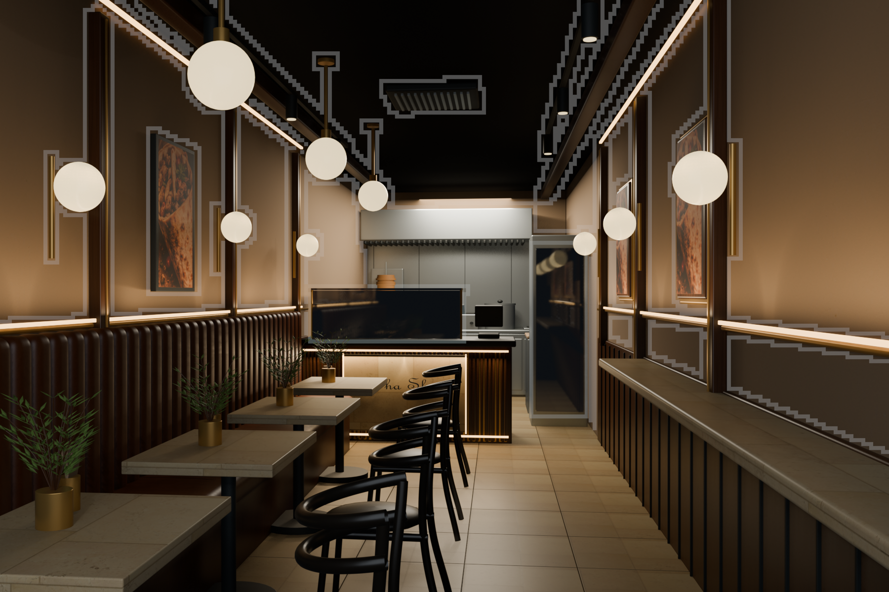
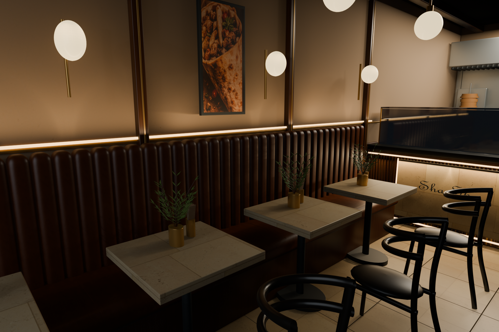

# Restaurant 3D - Design

### Sha Sha · Heritage Bistro · An immersive interior study

Explore a warm restaurant interior through an interactive **Three.js walkthrough**, with editable **Blender scenes**, rendered design studies, and downloadable **glTF assets**.



## The experience

The A01 design study brings together walnut joinery, cognac leather, cream stone, ivory walls, and brass lighting. Move through five connected viewpoints: **storefront → entrance → dining room → service counter → kitchen**.

- Eye-level exploration with mouse or touch look controls and keyboard movement.
- A guided tour, section navigation, and an interactive concept plan.
- Cutaway, gallery lighting, fullscreen, and reset controls.
- A concept-image comparison and two detailed Blender interior renders.
- An included browser-ready model and editable offline scene masters.

## Run locally

You need **Python 3** and a modern browser with WebGL support. The website is already built: no npm installation or bundler is required. Three.js and its supporting modules are included locally.

```sh
git clone https://github.com/PCTEJA/Restaurant-3D-Design.git
cd Restaurant-3D-Design
python -m http.server 4173 --directory dist
```

Open **http://localhost:4173**. On Windows, use `py` instead of `python` if needed. Serve the site over HTTP; opening `index.html` directly does not provide the module and model loading environment it needs.

The repository is public and can be cloned without authentication.

> The active model is approximately **83 MB** (79 MiB). The initial load can take time on slower connections, and interactive performance depends on the device's graphics capabilities.

## Controls

| Action | Control |
| --- | --- |
| Enter the interactive view | **Explore in 3D** |
| Look around | Drag within the scene |
| Walk | **W / A / S / D** or arrow keys |
| Move on touch devices | On-screen forward / backward buttons |
| Jump to a space | Section buttons or the concept plan |
| Start or pause the tour | **Guided tour** |
| Reveal the layout | **Cutaway** |
| Adjust the presentation | **Gallery light** |
| Restore the view | **Reset view** |
| Compare with the reference | **View concept image** |

## Project structure

```text
.
├── dist/                         Ready-to-serve static website
│   ├── index.html                Page structure and design notes
│   ├── app.js                    Three.js scene, navigation, and controls
│   ├── style.css                 Responsive visual design
│   ├── assets/                   Models, concept reference, and renders
│   ├── vendor/                   Three.js, loaders, environment, and license
│   └── utils/                    Supporting geometry utilities
├── blender/                      Editable scenes and generation scripts
│   ├── Sha-Sha-A01-Matched.blend  Reference-calibrated interior master
│   ├── Sha-Sha-GPU.blend          Eevee scene used for final imagery
│   ├── Sha-Sha-Premium.blend      Earlier premium scene
│   ├── Sha-Sha-Ultra.blend        High-detail Cycles master
│   ├── gpu_pipeline.py           Final Eevee renders and browser export
│   └── textures/                 Scanned maps, manifest, and attribution
└── website-preview.png           Website overview
```

## Models and render pipeline

| Asset | Purpose |
| --- | --- |
| `dist/assets/heritage-a01.glb` | Active Three.js model exported from the A01 scene |
| `dist/assets/heritage-a.glb` | Earlier browser export retained for comparison |
| `dist/assets/gpu-arrival.png` | Final arrival view rendered with Eevee |
| `dist/assets/gpu-dining.png` | Final dining detail rendered with Eevee |
| `blender/Sha-Sha-A01-Matched.blend` | Editable reconstruction with packed scanned materials |
| `blender/Sha-Sha-Ultra.blend` | Separate high-detail scene for offline Cycles work |

### Regenerate the current website assets

The scene scripts were authored with **Blender 5.2**. Run commands from the repository root with Blender installed and available on your PATH, or substitute the full path to its executable.

```sh
blender -b --python blender/gpu_pipeline.py
```

This opens the included A01 master, saves `Sha-Sha-GPU.blend`, renders the two final stills, and exports `dist/assets/heritage-a01.glb`. It overwrites those generated outputs and can take substantial time and memory.

### Rebuild the reference-matched scene

The included `.blend` files let you start editing without regenerating every stage. For a procedural rebuild, the relevant sequence is:

```sh
blender -b --python blender/premium.py
blender -b --python blender/match_a01.py
python -m pip install requests
python blender/fetch_materials.py
blender -b --python blender/finish_a01.py
blender -b --python blender/gpu_pipeline.py
```

Fetching textures requires internet access. Run `fetch_materials.py` before reapplying materials on a different computer: it regenerates the texture manifest with paths for that machine. The saved matched scene already contains packed textures.

`blender/ultra.py` generates the separate high-detail Cycles revision from the premium scene. The legacy premium pipeline also performs Cycles rendering and baking, so a complete rebuild is considerably heavier than serving the existing website.

### Rendering notes

The final stills use Eevee at 1800 × 1200 with 128 temporal samples. The original workstation used Intel Iris Xe for Eevee; Cycles exposed CPU rendering on that machine. Select a render backend supported by your own hardware for offline work.

The browser uses a real-time approximation of the Blender materials and lighting. Blender height-based bump shading is not preserved by the current export, and gallery lighting is a presentation adjustment rather than a physical simulation of changing daylight.

## Hosting

### Cloudflare Workers Free

Run `npm ci` followed by `npm run deploy`. The configuration targets the
Pcteja1028 Cloudflare account and publishes only static assets; it does not
enable a paid service. Sign into that account with Wrangler before deploying.

`npm run build` prepares `.cloudflare-dist/`, using the Draco-compressed
7.82 MB model in place of the original 82.69 MB model. The original stays in
`dist/assets/heritage-a01.glb` for editing. The local Draco decoder is bundled
with the site. The build verifies that every published asset is under 25 MiB.

For Cloudflare Git builds, use `npm run build` as the build command and
`npx wrangler deploy` as the deploy command, with the repository root directory.
The deployment name is `sha-sha-heritage-bistro`.

Deploy the contents of **`dist/`** to a static host. Keep `assets/`, `vendor/`, and `utils/` alongside `index.html`; no server-side application or build command is required. Relative asset paths support hosting beneath a repository subpath.

The large GLB should be served with the correct binary content type and caching. If first-load speed matters, model and texture optimization is the main next step. Creating this GitHub repository does not automatically publish a live website.

## Design scope

This is an **architectural concept visualization**, interpreted from the A01 reference image. It assumes a 10-foot internal width; the final depth is calibrated visually to the reference. Earlier iterations used a longer envelope.

It is not a measured survey, construction drawing, or fabrication model. Equipment dimensions, accessibility, circulation clearances, and site conditions require independent verification before real-world implementation.

## Credits and usage

- **Three.js**: included vendor code is covered by its [MIT license](dist/vendor/THREE-LICENSE.txt).
- **Poly Haven**: scanned [Beige Wall 001](https://polyhaven.com/a/beige_wall_001), [Brown Leather](https://polyhaven.com/a/brown_leather), and [Marble 01](https://polyhaven.com/a/marble_01) materials are CC0. See [texture sources](blender/textures/SOURCES.md).
- Original project code, scene files, artwork, and design references have no additional open-source license granted by this repository. Third-party components retain their own terms.


